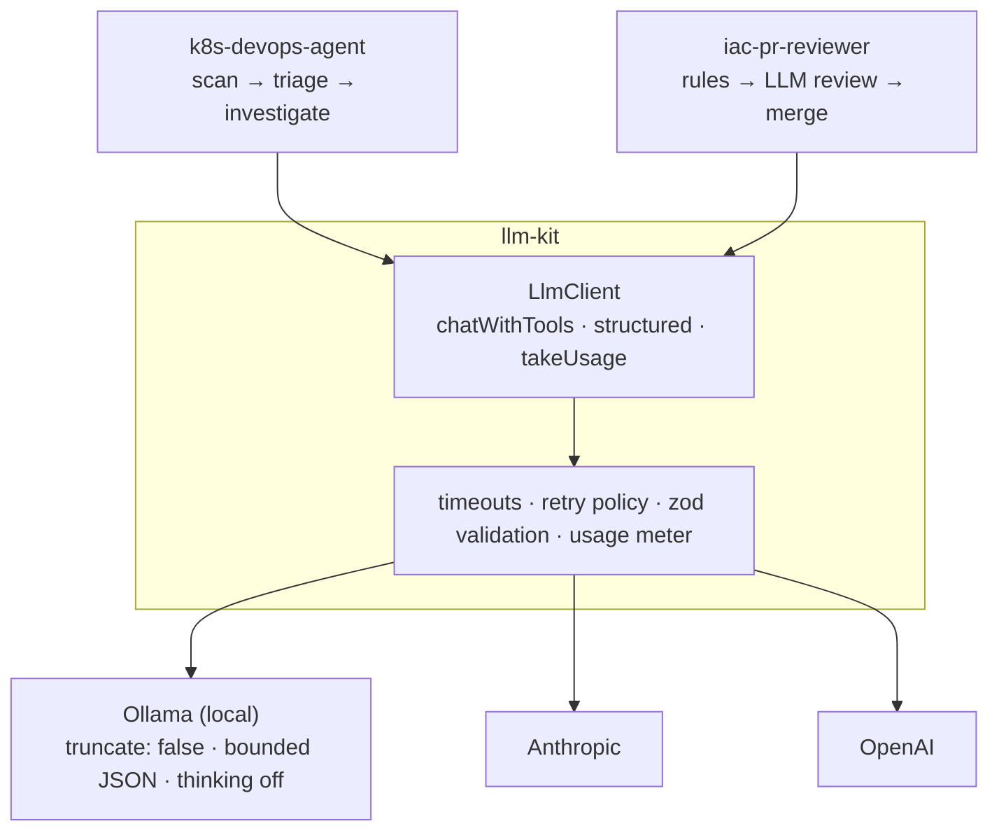

# llm-kit

The LLM layer shared by two DevOps tools:

- [**k8s-devops-agent**](https://github.com/meirakrish/k8s-devops-agent): read-only Kubernetes health checks with LLM triage and root-cause investigation
- [**iac-pr-reviewer**](https://github.com/meirakrish/iac-pr-reviewer): risk review of Terraform plans in pull requests

Both tools follow the same pattern: deterministic rules first, an LLM on top to reason about what the rules found, and a rule-based fallback when the LLM fails. This package is the part they have in common: talking to a model reliably, with local models treated as a first-class target rather than an afterthought.



## What it handles

| Problem                                                            | What llm-kit does                                                                                                                                    |
| ------------------------------------------------------------------ | ---------------------------------------------------------------------------------------------------------------------------------------------------- |
| Switching between local and hosted models                          | One config for Ollama, Anthropic and OpenAI. A present API key picks its provider; otherwise local Ollama. Hosted SDKs load only when used.          |
| Ollama silently drops the start of prompts longer than its context | Sends `truncate: false`, so an oversized prompt fails with a clear `ContextOverflowError` ("prompt (20000 tokens) does not fit…; raise LLM_NUM_CTX") |
| Small models write one string forever                              | Length limits on structured-output fields, enforced by Ollama's constrained decoding, plus an output token cap                                       |
| Thinking models spend the output budget reasoning                  | Turns thinking off, only for models that support it (others reject the option)                                                                       |
| Invalid or truncated JSON answers                                  | Validates every structured answer against its zod schema and retries once                                                                            |
| Transient local GPU failures (e.g. CUDA errors under WSL)          | Retries Ollama calls once; never retries what will fail the same way again (overflow, timeout, server down)                                          |
| Knowing what a run cost                                            | Meters token usage per call, including calls inside structured output, with a peak-prompt figure to compare against the context window               |
| Testing code that calls an LLM                                     | A small `LlmClient` interface and a scripted fake in `@meirakrish/llm-kit/testing`                                                                   |

It also defines the conventions both tools share: one severity scale (`low` < `medium` < `high` < `critical`), `--fail-on` thresholds, and the LLM metadata block in JSON reports.

## Design decisions

- **Rules decide, the LLM explains.** In both tools the verdict comes from deterministic rules: the agent's severity and exit code come only from rules, and the reviewer's LLM can raise the risk but never lower it. llm-kit supports that split by making every call end in one of two ways, schema-valid data or an error, so the caller can always fall back to its rule-based result.
- **Fail loudly instead of degrading silently.** By default Ollama drops the start of an over-long prompt and lets a small model generate until it runs out of tokens. Both produce confident answers from partial input. llm-kit turns them into errors instead: `truncate: false` with an actionable `ContextOverflowError`, an output token cap, and length limits enforced by constrained decoding.
- **Retry only what a retry can fix.**

  | Failure                                                | Retried?                                      |
  | ------------------------------------------------------ | --------------------------------------------- |
  | Unusable structured answer (bad JSON, schema mismatch) | once, every provider                          |
  | Transient local GPU error                              | once, Ollama (hosted SDKs retry on their own) |
  | Context overflow, timeout, server unreachable          | never: it would fail the same way             |

- **A small interface, not a framework.** Tools depend on `LlmClient` (three methods), not on LangChain models. Tests drive the tools with a scripted fake, and providers can change without touching tool code.
- **Data policy belongs to the tool.** By default a present API key selects its hosted provider. k8s-devops-agent overrides that, so cluster data stays on the machine unless `LLM_PROVIDER` names a hosted provider. iac-pr-reviewer keeps the default, because a CI job with an API key is its expected setup.
- **Shared conventions, not just shared code.** The severity scale, the `LLM_*` settings and the LLM block in JSON reports are defined here, so both tools configure and report the same way.
- **Published from CI, ready-built.** Tagging a version builds the package in CI, publishes it to npm with a provenance attestation, and attaches the same tarball to a GitHub Release. Projects get the compiled `dist/`, so there is no build step at install time.

## Usage

```ts
import { HumanMessage, SystemMessage } from "@langchain/core/messages";
import { z } from "zod";
import { createLlmClient, resolveLlmConfig, Severity } from "@meirakrish/llm-kit";

const Review = z.object({
  riskLevel: Severity,
  summary: z.string(),
  findings: z.array(z.object({ resource: z.string(), issue: z.string() })),
});

const llm = await createLlmClient(resolveLlmConfig({ model: flags.model }), {
  overflowHint: "raise LLM_NUM_CTX or lower MAX_PLAN_CHARS",
});

const review = await llm.structured(Review, [new SystemMessage(SYSTEM), new HumanMessage(plan)], {
  name: "iac_review",
  limits: { summary: 700, findings: 20, "findings[].issue": 400 }, // applied for Ollama only
});

console.log(review.riskLevel, llm.takeUsage()); // { calls: 1, promptTokens: 5321, ... }
```

For an agent loop, `llm.chatWithTools(messages, tools)` runs one turn in which the model may call tools.

### Testing

```ts
import { scriptedLlm } from "@meirakrish/llm-kit/testing";

const llm = scriptedLlm({ structured: [{ riskLevel: "high", summary: "…", findings: [] }] });
await reviewPlan(plan, { llm });
expect(llm.calls[0]?.name).toBe("iac_review");
```

## Configuration

Flags passed to `resolveLlmConfig` win over environment variables, which win over defaults. Empty values count as unset.

| Variable                | Default                  | Notes                                                         |
| ----------------------- | ------------------------ | ------------------------------------------------------------- |
| `LLM_PROVIDER`          | detected                 | `ollama`, `anthropic` or `openai`                             |
| `LLM_MODEL`             | per provider             | `qwen3.5:9b`, `claude-sonnet-5-5`, `gpt-5-mini`               |
| `OLLAMA_HOST`           | `http://localhost:11434` | Ollama's own variable; `host:port` and `0.0.0.0` are handled  |
| `LLM_NUM_CTX`           | `16384`                  | Ollama context window                                         |
| `LLM_MAX_OUTPUT_TOKENS` | `4096`                   | Cap on generated tokens                                       |
| `LLM_TIMEOUT_MS`        | `180000`                 | Per request                                                   |
| `ANTHROPIC_API_KEY`     |                          | Selects Anthropic when no provider is set                     |
| `OPENAI_API_KEY`        |                          | Selects OpenAI when no provider is set (and no Anthropic key) |

Tool-specific settings belong to each tool, with its own prefix.

## Install

```bash
pnpm add @meirakrish/llm-kit
pnpm add @langchain/core zod
# only for hosted providers:
pnpm add @langchain/anthropic   # and/or @langchain/openai
```

`@langchain/core` and `zod` are peer dependencies, so the tool and llm-kit share one copy (messages and schemas cross the boundary).

## Releasing

1. Bump `version` in `package.json` and merge.
2. Tag the merge commit: `git tag v0.2.0 && git push --tags`.
3. The Release workflow checks the tag matches `package.json`, runs the tests, publishes the package to npm, and attaches it to a GitHub Release.

npm accepts the publish through trusted publishing: the package's settings on npmjs.com trust this repo's `release.yml`, so no npm token is stored anywhere.

## Development

```bash
pnpm install
pnpm typecheck && pnpm test && pnpm format:check
pnpm build
```

## License

MIT
